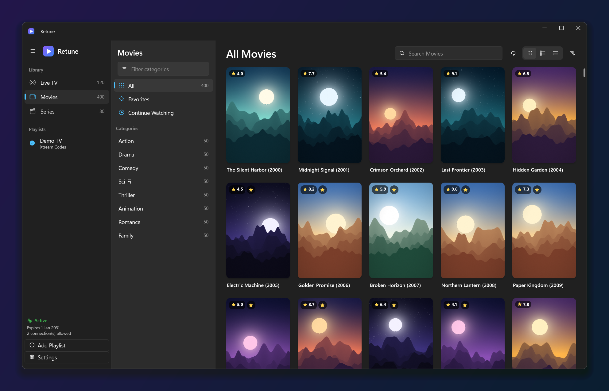
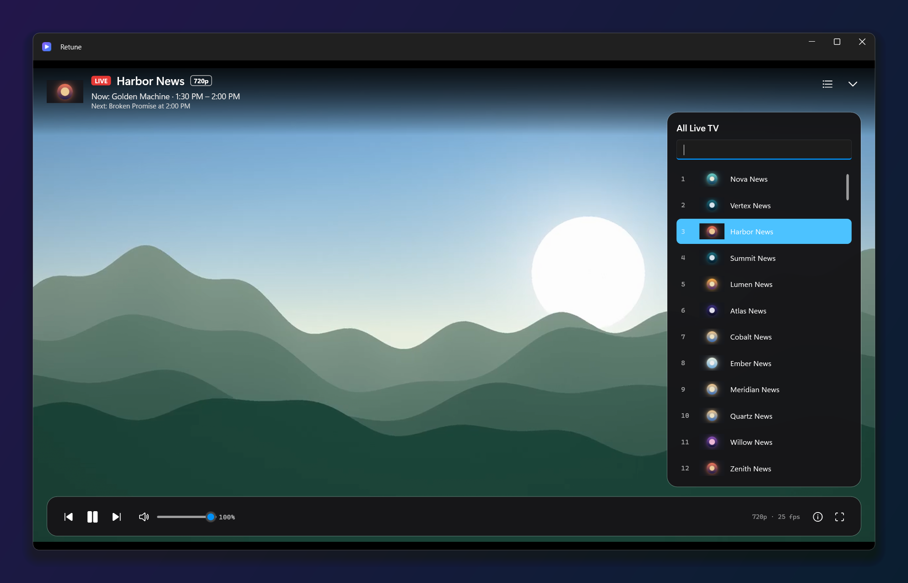
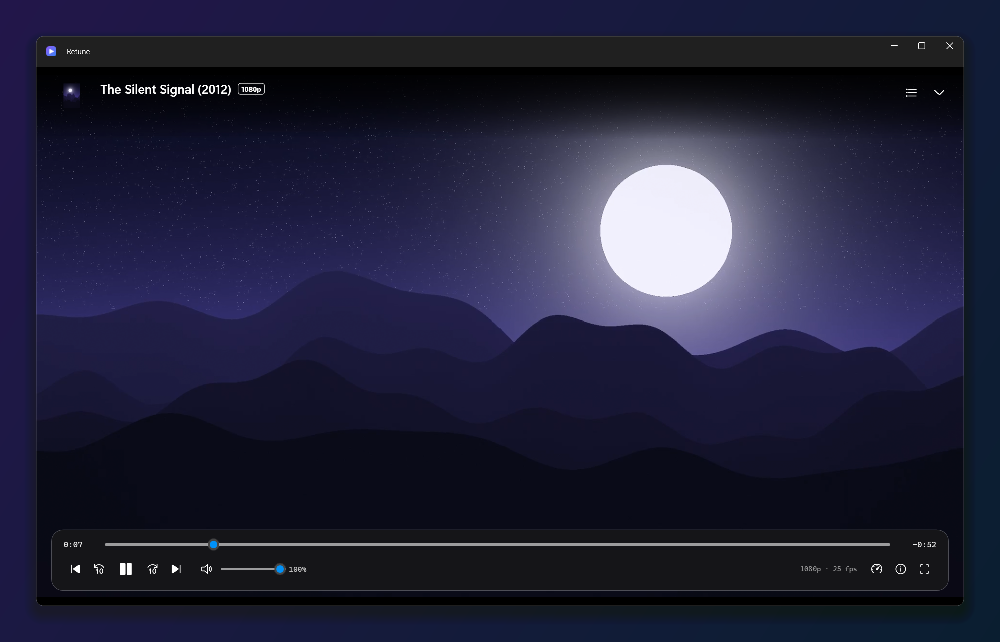
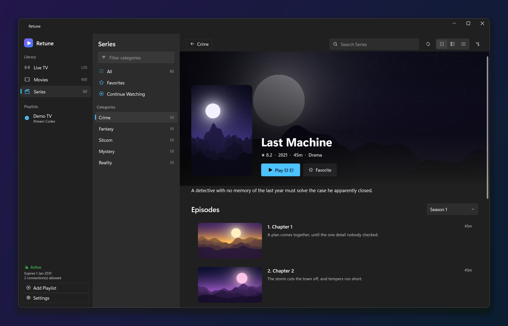
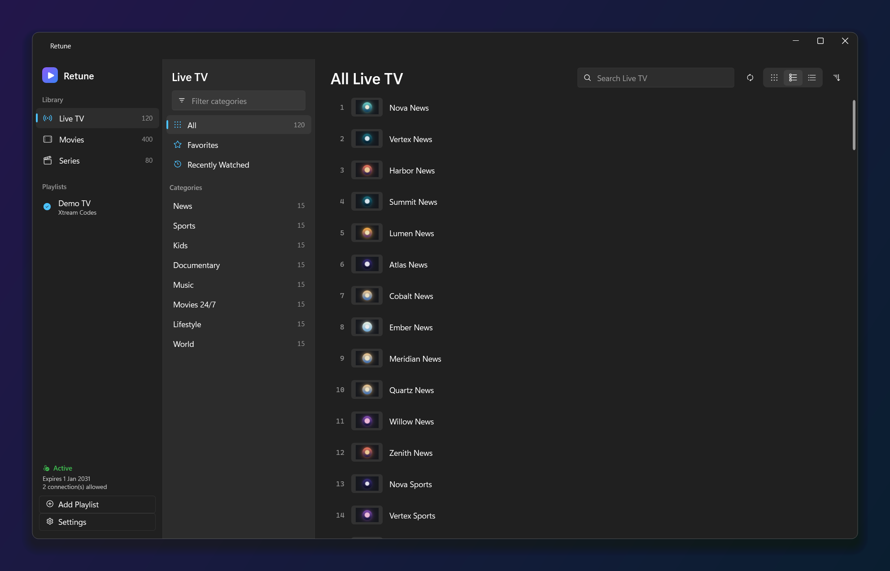
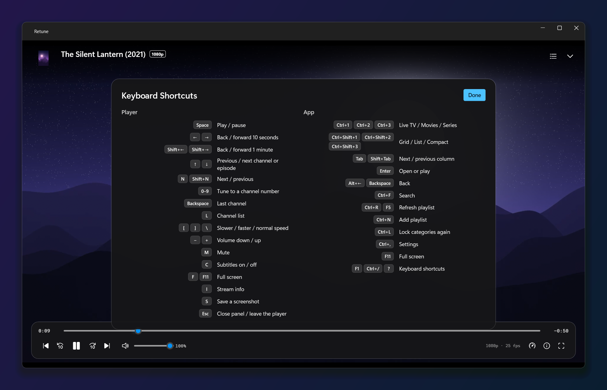
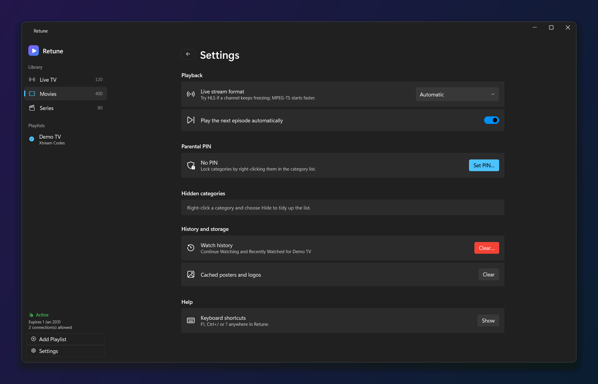

# Retune for Windows

A fast, private, keyboard-friendly IPTV player for Windows 10 and 11. Bring your Xtream Codes account or M3U
playlist and browse Live TV, Movies and Series in a native Fluent interface, with smooth hardware-accelerated
playback by [mpv](https://mpv.io). Free and open source (GPL-3.0-or-later). No accounts, ads or tracking.



> Retune is only a player. It comes with no channels, playlists or media: you bring your own legal source.
> Every screenshot here shows synthetic demo data from the repository's own fake provider.

## Features

- **Xtream Codes and M3U** playlists (URL or local file), several playlists side by side, with the provider's
  account status and expiry in the sidebar.
- **Live TV, Movies and Series** with categories, a category filter, accent-insensitive search, sorting, and
  three layouts (grid, list, compact) at three tile sizes. Smooth with 80,000+ items.
- **Detail pages** for movies and series: artwork, plot, cast, seasons and episodes.
- **Favorites, Continue Watching and Recently Watched**, resume points, watched marks and "play next episode".
- **A TV-remote player**: zap with ↑/↓ or PgUp/PgDn (debounced, so the provider's single connection is freed
  at once), type a channel number, flip to the last channel with Backspace, channel list with filter, now/next
  programme guide, automatic reconnect, audio and subtitle tracks, subtitle size and position, playback speed,
  stats for nerds, screenshots to `Pictures\Retune`, full screen.
- **Windows integration**: media keys and the Windows media flyout, single instance, sleep prevention while
  playing, Mica, dark Fluent design, screen-reader names on every control.
- **Parental PIN**: lock categories; locked content never leaks into All, search, favorites or history.
  Wrong PINs pause entry (30 s, then 1 min, then 5 min).
- **Keyboard first, mouse friendly**: every action has a shortcut (press **F1**, **Ctrl+/** or **?** for the full list),
  and the player answers the mouse too: the wheel zaps channels on live TV and sets the volume on films, middle-click
  mutes, right-click opens a player menu, and the mouse's Back button leaves the player.
- **Your layout, remembered**: app-wide zoom (75–200%), a sidebar that collapses to an icon rail, and the window's
  size, position and maximised state all come back the next time you open Retune.

| | |
| --- | --- |
|  |  |
|  |  |
|  |  |

## Install

Requirements: Windows 10 version 2004 (build 19041) or later, or Windows 11, on a 64-bit PC. Nothing else: the
packages include the .NET runtime and libmpv.

### Installer (recommended)

1. Download `Retune-<version>-setup.exe` and, optionally, `SHA256SUMS.txt` from the
   [latest release](https://github.com/0xAliRaza/retune-windows/releases/latest).
2. Optional, to check the download: `Get-FileHash .\Retune-<version>-setup.exe -Algorithm SHA256` and compare it
   with the line in `SHA256SUMS.txt`.
3. Run the installer. It installs for your Windows user only, into `%LOCALAPPDATA%\Programs\Retune`, so it never
   asks for administrator rights.
4. Builds aren't code-signed yet, so Windows SmartScreen may say *"Windows protected your PC"*. Choose
   **More info**, then **Run anyway**.
5. Start Retune from the Start menu and choose **Add Playlist**.

Silent install (for scripts): `Retune-<version>-setup.exe /VERYSILENT /SUPPRESSMSGBOXES`.

### Portable zip

Unzip `Retune-<version>-win-x64.zip` (from the same release) anywhere and run `Retune.exe`. Your playlists and settings are still kept in
your user profile (see [Your data](#your-data)), not next to the exe.

### Build from source

You need the [.NET 10 SDK](https://dotnet.microsoft.com/download) and, for the tests, FFmpeg.

```powershell
winget install Microsoft.DotNet.SDK.10
winget install Gyan.FFmpeg                 # only for generating the test videos

./tools/fetch-libmpv.ps1                   # the pinned libmpv build, checked against its SHA-256
./tools/make-test-media.ps1                # synthetic test videos (git-ignored)

dotnet build Retune.slnx                   # warnings are errors
dotnet test --solution Retune.slnx
dotnet run --project src/Retune.App
```

To build the release packages (self-contained publish, portable zip, installer and checksums in
`artifacts/dist`):

```powershell
winget install JRSoftware.InnoSetup --scope user   # once; per-user, no admin rights
./tools/package.ps1
```

## Using Retune

| Where | Keys |
| --- | --- |
| Anywhere | **Ctrl+1/2/3** Live TV / Movies / Series · **Ctrl+F** search · **Ctrl+N** add playlist · **Ctrl+R** or **F5** refresh · **Ctrl+,** settings · **Ctrl+L** lock categories again · **Ctrl+B** sidebar · **Ctrl+Plus/Minus/0** zoom (or Ctrl + wheel) · **F11** full screen · **F1** shortcuts |
| Browsing | **Tab** next column · **Enter** open or play · **Alt+←**, **Backspace** or the mouse's Back button go back · **Ctrl+Shift+1/2/3** grid / list / compact |
| Player | **Space** play/pause · **←/→** 10 s (**Shift** 1 min) · **↑/↓** previous/next · **0–9** channel number · **Backspace** last channel · **L** channel list · **M** mute · **−/+** volume · **C** subtitles · **[ ] \\** speed · **I** stats · **S** screenshot · **F** full screen · **P** picture-in-picture · **Esc** close |
| Player, mouse | **Click** play/pause · **Double-click** full screen · **Wheel** channels (live) or volume (films) · **Shift + wheel**, or the wheel over the speaker or volume slider, volume · **Middle-click** mute · **Right-click** player menu · **Back button** leave the player |

Settings (the gear at the bottom of the sidebar) cover zoom, the live stream format (Automatic shows what it picks for
your playlist, or choose MPEG-TS or HLS), autoplay of the next episode, the parental PIN, hidden categories (collapsed,
so their names stay out of sight until you open the section), clearing watch history and clearing the artwork cache.

## Your data

| What | Where | Protection |
| --- | --- | --- |
| Playlists, favorites, history, settings, catalog cache | `%APPDATA%\Retune` | Folder readable only by you (and SYSTEM). Playlists and catalogs are encrypted with Windows DPAPI for your user. |
| Xtream passwords | Windows Credential Manager (`Retune/…`) | Encrypted by Windows; never written to Retune's files. |
| Poster and logo cache, logs | `%LOCALAPPDATA%\Retune` | Disposable. Logs never contain URLs, user names or passwords. |

Retune connects only to your provider and to the artwork hosts your playlist names. It sends no telemetry.
Every HTTPS connection verifies the server's certificate: the API and artwork through Windows, and video streams
against the roots Windows trusts (refreshed at each start). A stream whose certificate can't be verified isn't played
and your login isn't sent; if you trust that provider, Settings › Playback › **Allow unverified HTTPS streams** lets it
through.
mpv runs with scripts, youtube-dl and unsafe playlists disabled, every network response is size-capped, and
stream URLs are checked against an allowlist of schemes.

**Uninstalling** from Settings › Apps (or the Start menu) asks whether to also delete your data. Choose **Yes** to
remove the folders above and the passwords Retune saved; choose **No** to keep them for a later reinstall. With the
portable zip, delete the folder; `Retune.exe --purge-data` removes your data and saved passwords.

## Compared with the macOS app

Retune for Windows is a fresh build of the [macOS app](https://github.com/0xAliRaza/retune), not a port: the same
features and feel, adapted to Windows. These are the places where it now differs, kept here so they can be brought back
to the macOS version.

**New on Windows**

- Numeric channel entry: type a channel number in the player (shown on screen, tunes after 1.5 s or Enter).
- System media controls: media keys and the Windows media flyout (title and now-playing guide line).
- Mouse controls in the player: wheel zaps channels on live TV and sets the volume on films (Shift + wheel is always
  volume), middle-click mutes, right-click player menu (tracks, speed, list, stats, screenshot, shortcuts), mouse Back
  button leaves the player.
- App-wide zoom (Ctrl+Plus/Minus/0, Ctrl + wheel, Settings › Appearance).
- Collapsible sidebar (Ctrl+B) to an icon rail.
- Window size, position and maximised state are remembered.
- Parental PIN lockout after 5 wrong tries (30 s, then 1 min, then 5 min); the unlock prompt says which.
- Delete-playlist confirmation.
- Keyboard Shortcuts sheet on F1, Ctrl+/ and ? everywhere (macOS: ? in the player only), with a mouse section.
- Settings as a page in the main window; the live format shows what Automatic picked; hidden categories are a
  collapsed section; "N hidden" no longer appears under the category list.
- Verified HTTPS for video streams too (against Windows' trusted roots), with a clear message and an opt-out in
  Settings for providers whose certificates can't be verified.
- Seeking explains itself: a refused forward jump (servers without range support, unknown length) shows why instead
  of doing nothing.
- Screenshots at source resolution, saved to `Pictures\Retune`.
- Single instance: a second launch brings the first window forward.
- Data at rest: playlists and catalogs encrypted with DPAPI, data folder restricted to the user, uninstaller offers to
  remove data and saved passwords, redacted diagnostic log.

**Deliberately different**

- Ctrl+1–3 don't change the section while the player is open (macOS changes it underneath).
- Layout shortcuts are Ctrl+Shift+1–3; Back is Alt+←, Backspace or the mouse's Back button.
- The favourite icon is a star everywhere (macOS mixes heart and star).
## Roadmap

Planned, roughly in order. Nothing here is promised by a date.

1. **Seeking on every provider**: some servers don't allow jumping ahead in a stream (no HTTP range support).
   Retune now says so instead of doing nothing; next is making forward jumps work there too.
2. **Code-signed releases**, so Windows SmartScreen stops warning on download and install. This needs a code-signing
   certificate; until then builds are unsigned (see [Install](#install)).
3. **A full TV guide**: a schedule grid for live channels from the provider's EPG, beyond today's now/next line.
4. **Catch-up (timeshift)** on live channels whose provider offers it: watch what aired earlier.
5. **In-app updates** from GitHub Releases, verified against published checksums.
6. **A smaller download**: about 50 MB of the package is a Windows component used only for the media keys and
   flyout; projecting just the part Retune uses removes most of it.
7. **Smoother grid scrolling at very large sizes** (60,000+ posters): recycle tiles instead of rebuilding rows.
8. **1.0 release**: a 4-hour playback soak test (a 1-hour one passes today), a final review, version 1.0.
9. **Hardening**: keep artwork requests off your local network, restrict which protocols streams may use inside
    HLS/DASH, limit concurrent artwork downloads, and clean up very old history entries saved before locators.
10. **Linux**: a version for Ubuntu and other distributions, sharing the .NET core and view models with an Avalonia
    interface, libmpv in an OpenGL view, the desktop keyring for passwords and MPRIS for media keys.
## How it's built

C# on .NET 10 with WPF and [WPF-UI](https://github.com/lepoco/wpfui) (Fluent design, Mica), CommunityToolkit.Mvvm,
and libmpv. The decisions behind it are in [docs/PLAN.md](docs/PLAN.md); behaviour is specified in
[docs/spec/core.md](docs/spec/core.md) and [docs/spec/ui-player.md](docs/spec/ui-player.md).

```
src/Retune.Core            pure domain logic: models, Xtream and M3U, search, library, PIN, playback rules
src/Retune.Infrastructure  storage (atomic, DPAPI), Credential Manager, HTTP, artwork cache, logging
src/Retune.Mpv             libmpv interop: MpvClient (event loop, typed properties) and MpvEngine
src/Retune.Presentation    view models, independent of WPF
src/Retune.App             WPF views, video and overlay hosts, Windows integration
tests/                     xUnit v3 on Microsoft Testing Platform
tools/                     libmpv fetch, test media, fake provider, packaging, screenshots
installer/                 Inno Setup script (per-user)
```

**Video without "airspace" problems.** mpv renders into a native child window with its own D3D11 swap chain on its
own thread, so a busy UI thread never makes the video stutter. The player controls are WPF content in a
per-pixel-transparent child window stacked above it, which moves, resizes and goes full screen with the main
window.

## Quality

- **546 automated tests**: domain logic and edge cases, storage crash-safety and corruption, Credential Manager,
  HTTP limits and timeouts against a local server, view models against an in-process fake provider, and real mpv
  playback of generated media. CI runs them on every push.
- **Zero analyzer warnings**: `latest-recommended` analysis with warnings as errors.
- **Measured at scale** (Release build, 16,000 channels + 65,000 movies + 7,000 series from the fake provider):
  download, decode and index in about 0.9 s; switching sections about 0.3 s; list scrolling at a median 7.8 ms per
  wheel step; managed memory about 180 MB with everything loaded.
- **Accessibility**: every button has a screen-reader name, including the player controls drawn over the video.

## Developer options

These only help development and testing; regular users never need them.

| Option | What it does |
| --- | --- |
| `--demo <provider url>` | Adds a demo playlist for the fake provider (`tools/FakeProvider`) |
| `--autoplay` | With `--demo`, plays the first channel |
| `--mute` | No audio device at all, so nothing can be heard |
| `--no-activate` | Opens without taking keyboard focus |
| `--window x,y,w,h` | Places the window at these physical-pixel bounds |
| `--render <folder>` | With `--demo`, renders the main screens to PNG without showing a window |
| `--tour <folder>` | With `--demo`, walks the real window through the main screens and saves screenshots |
| `--perf <report>` | With `--demo`, measures load, navigation, search and scrolling and writes a report |
| `--purge-data` | Deletes your Retune data and saved passwords (used by the uninstaller) |

`RETUNE_DATA_DIR=<folder>` keeps all data, caches, logs and saved passwords (under a separate `Retune-Dev/`
prefix) apart from your real ones. `tools/make-screenshots.ps1` regenerates the screenshots in this README.

## License

GPL-3.0-or-later. See [LICENSE](LICENSE) and [THIRD-PARTY-NOTICES.md](THIRD-PARTY-NOTICES.md).
